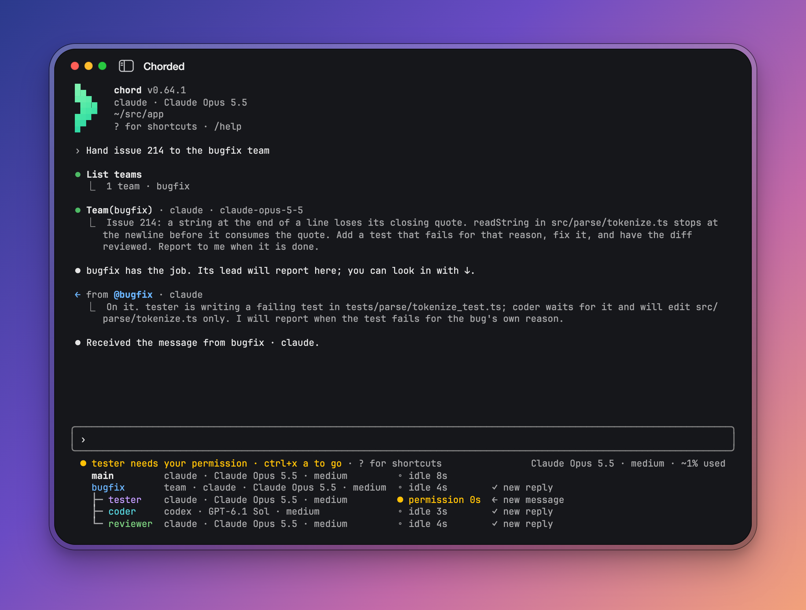
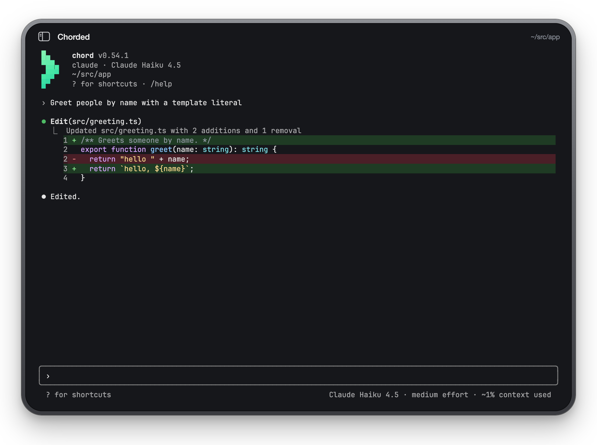
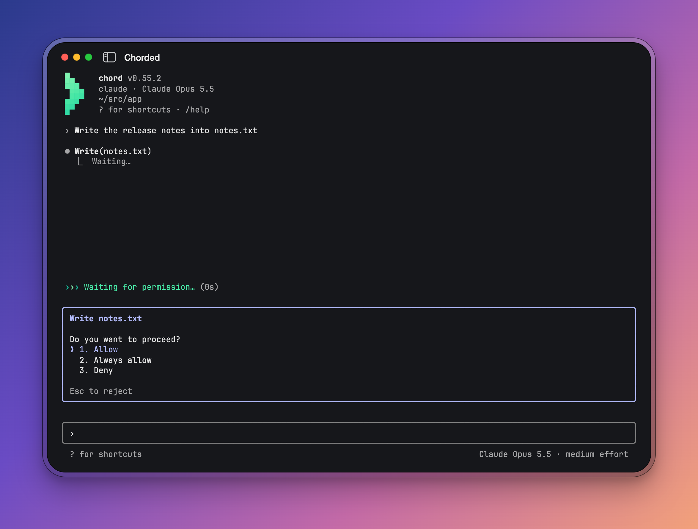
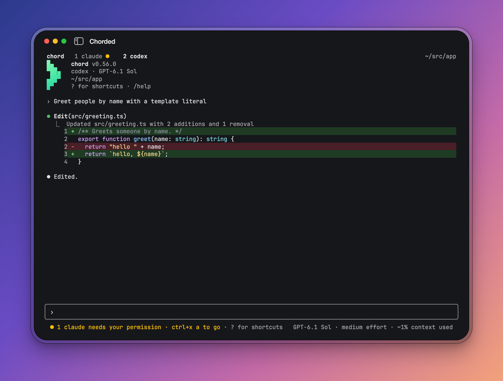
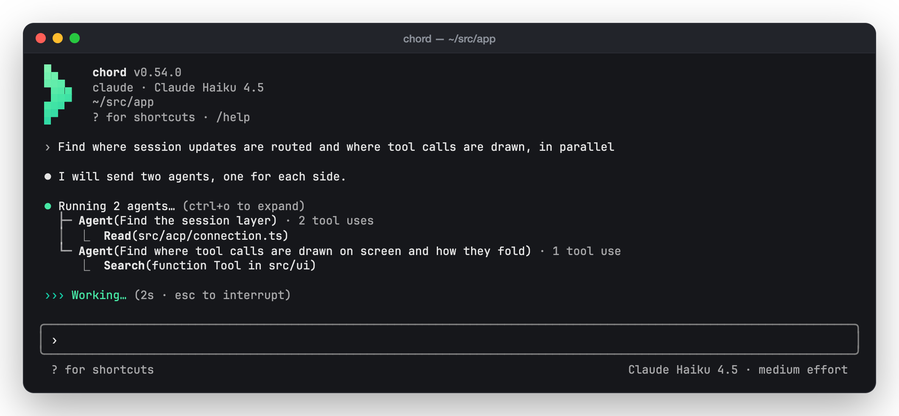
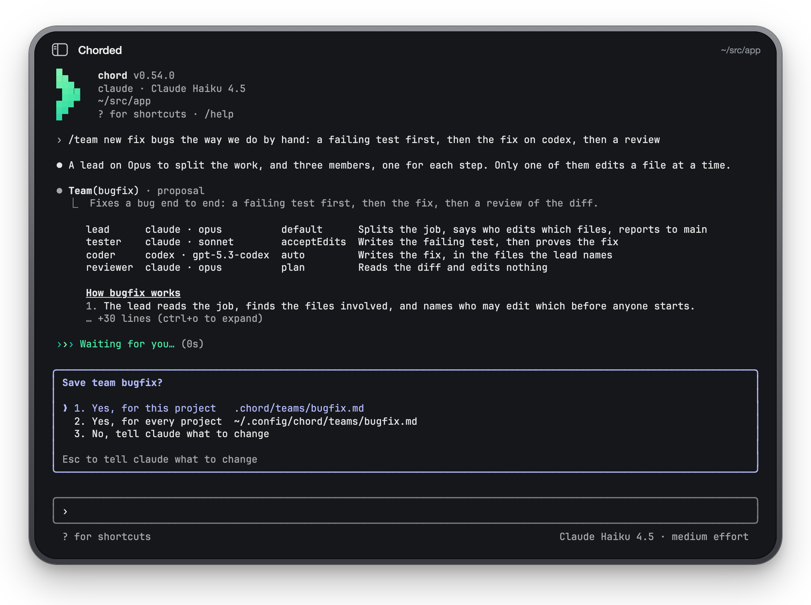
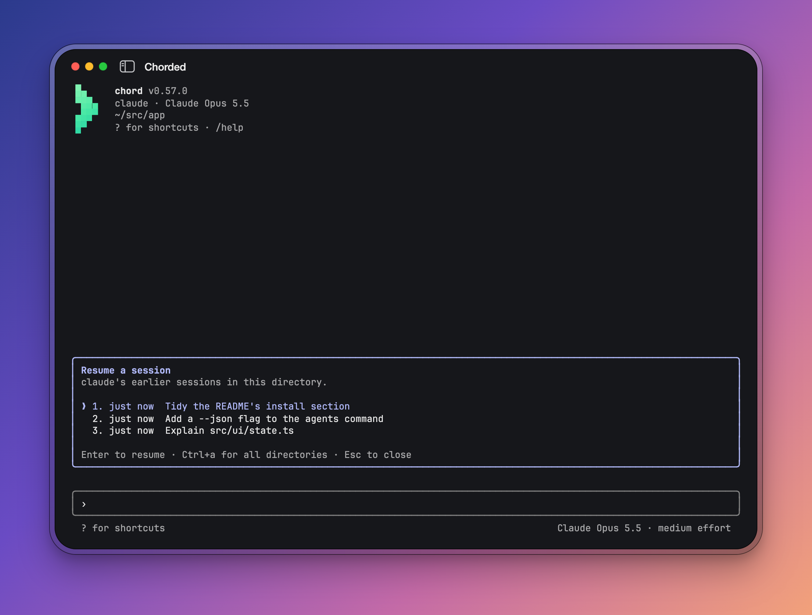

<h1 align="center">chord</h1>

<p align="center">
  <strong>One terminal for every coding agent.</strong><br>
  Claude Code, Codex, Gemini CLI, Cursor, OpenCode and 31 more, in one
  keyboard-driven window, side by side, working as a team.
</p>

<p align="center">
  <a href="https://www.npmjs.com/package/@chorded/chord"></a>
  <a href="https://github.com/IKatsuba/chord/actions/workflows/ci.yml"></a>
  <a href="LICENSE"></a>
  
</p>

<p align="center">
  
</p>

chord brings Claude Code, Codex, Gemini CLI and other coding agents into one
terminal interface: the same transcript, diffs, permission prompts, slash
commands, `@` mentions and plans. It connects to agents through the
[Agent Client Protocol](https://agentclientprotocol.com).

Run agents side by side or give a task to a team. For example, have Codex
write a fix and Claude review it, each with its own model and role. Agents
exchange messages, permission requests come to you, and a saved team can
take on your next task.

```sh
npm install -g @chorded/chord
chord            # Claude Code, here
chord codex      # or any other agent
```

## Why chord

- **Any agent, one interface.** 36 agents out of the box, from the
  [ACP Registry](https://agentclientprotocol.com) and their own CLIs. Switch
  agents without relearning keys.
- **Agents that work together.** Open a second agent beside the one you talk
  to, hand a job to a saved team, and watch each of them in a list under the
  prompt. Messages go between them; permissions still come to you.
- **Every action has a key.** Nothing on screen needs a mouse. `?` lists them
  all, and a keybindings file moves them.
- **Nothing to set up.** One binary, no account, no daemon. chord starts the
  agent, keeps the session, and gives it back with `chord --continue`.
- **Open source.** MIT, built on [OpenTUI](https://github.com/anomalyco/opentui)
  and the [ACP SDK](https://github.com/agentclientprotocol/typescript-sdk).

## A tour

### Diffs you can read

Edits arrive as whole, numbered, highlighted diffs, with long lines wrapped
under their code.



### You stay in charge

Each permission the agent asks for is a choice under the transcript, answered
with a number or the arrows. Between turns, it leaves your typing alone:
ctrl+x a moves into the box to answer. `shift+tab` cycles permission modes.



### Many agents in one window

Up to nine sessions as tabs, each with its own agent, transcript and draft.
A tab in the background marks what it waits for, and `ctrl+x a` takes you
there.



### Subagents, folded

When the agent fans out, its subagents run as one tree; ctrl+o shows their
whole task, work and later messages. Stoppable subagents join monitors and
spawned tasks in the `background` summary under the agents list. From an
empty prompt, ↓ past the agents reaches it; Enter opens the list, where `x`
stops an item alone.



### Teams

Describe how you work and the agent proposes a team: a lead and its members,
each on the runtime, model and mode you want. Save it once, then hand it any
job with `/team run bugfix <job>`.



### Pick up where you left off

`/resume` lists this directory's earlier sessions and saved windows; quit a
window of several tabs and chord prints the one command that brings them all
back.



## Install

```sh
npm install -g @chorded/chord   # or bun, pnpm, yarn
```

The package is a small shim around a prebuilt binary for macOS and Linux,
arm64 and x64; the macOS binaries are signed and notarised. `chord upgrade`
updates it through the package manager that installed it.

chord starts each agent for you (through `npx` or `uvx`, or the agent's own
CLI where it has one), so the agent's own login is all it needs: sign in to
Claude Code, Codex or Gemini as you normally would.

To build from source, with [Bun](https://bun.sh) 1.4.2 or newer:

```sh
git clone https://github.com/IKatsuba/chord && cd chord
bun install
bun dev compile --install   # into ~/.local/bin/chord
```

## Use

```sh
chord                  # your default agent in this directory
chord gemini -C ~/src/app
chord agents           # every agent chord can start, and whether it is installed
chord --continue       # the latest session here, again
chord --resume         # pick an earlier session or window
chord -p "Explain src/main.tsx"          # one reply on stdout, for scripts
git diff | chord -p "Review this" --output-format json
```

Inside the window:

| Key               | Does                                         |
| ----------------- | -------------------------------------------- |
| `?`               | every key, on an empty prompt                |
| `/`               | slash commands, chord's and the agent's      |
| `@`               | mention a file                               |
| `!`               | run a shell command, its output for the agent |
| `alt+←` / `alt+→` | move by word in the prompt                    |
| `cmd+←` / `cmd+→` | line start/end, where the terminal passes it  |
| `shift+tab`       | cycle the permission mode                    |
| `ctrl+o`          | expand Read output and subagents             |
| `ctrl+x c` / `/new codex` | open another session as a tab        |
| `ctrl+x 1`…`9`    | go to a tab                                  |
| `esc`             | interrupt the turn                           |

Settings live in `~/.config/chord/settings.json` and the project's
`.chord/settings.json`: the default agent, each agent's model, effort and
mode, MCP servers, theme and notifications.

**[The guide](docs/guide.md)** has everything else: every flag, setting, key,
the team file format, chord's MCP tools for agents, and how sessions are
recorded.

## Supported agents

Claude Code, Codex, Gemini CLI, Copilot, Cursor, OpenCode, Cline, Qwen Code,
Kimi Code, Kiro, Goose, Junie, Factory Droid, Auggie, Kilo, bob, Devin, fx
and more: `chord agents` prints the full list, and any other ACP agent runs
with `chord --agent-command "my-agent --acp"`.

## Contributing

Issues and pull requests are welcome. [CONTRIBUTING.md](CONTRIBUTING.md) has
how to run chord from source against its scripted test agent, choose checks
for a change, and follow the code conventions. Found a security issue?
See [SECURITY.md](SECURITY.md).

The screenshots above are chord itself, run against that test agent and
captured by `bun dev screenshots`.

## Licence

chord's code is [MIT](LICENSE). The Chorded name and the chevron mark are
trademarks of Igor Katsuba and are not covered by the licence; a fork should
draw its own ([TRADEMARKS.md](TRADEMARKS.md)).

chord is the open sibling of [Chorded](https://chorded.app), a native macOS
workspace for agent sessions driven by key chords.
