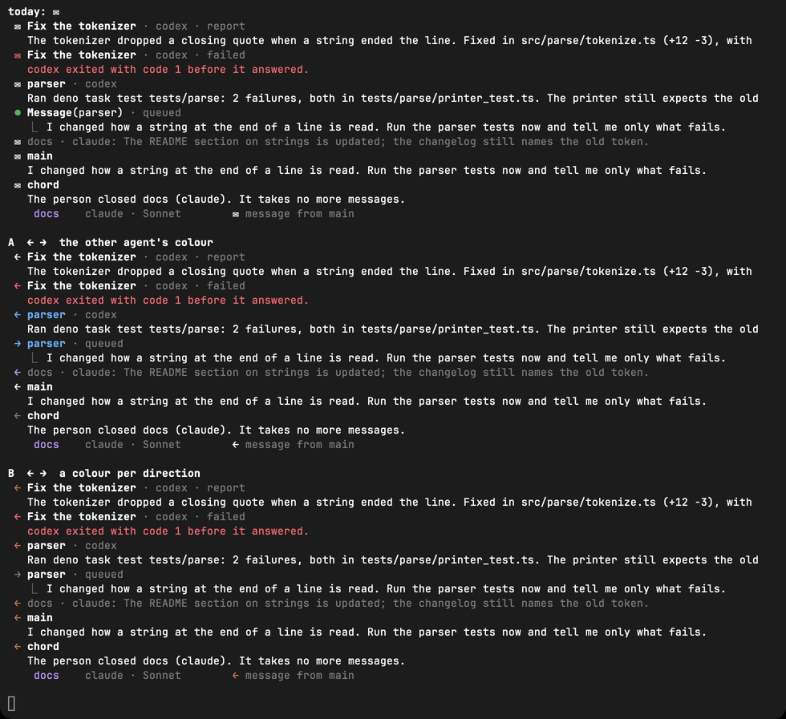
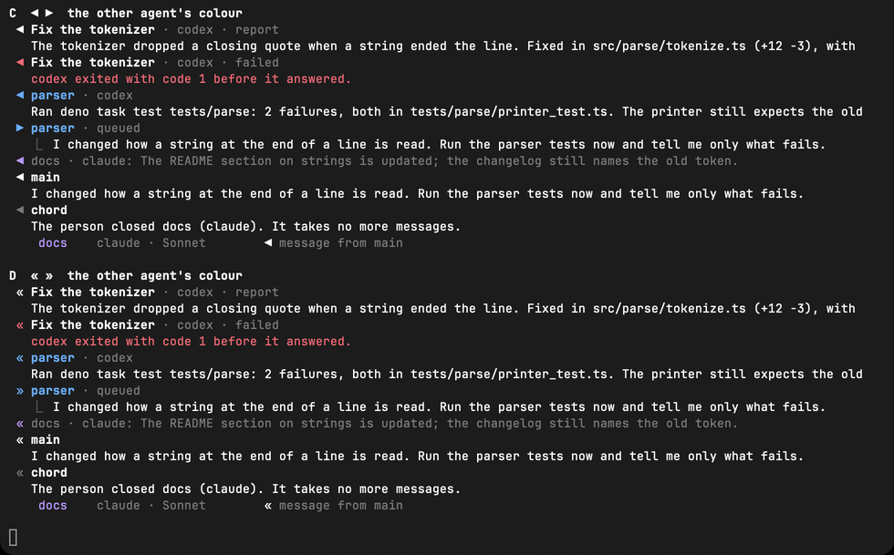
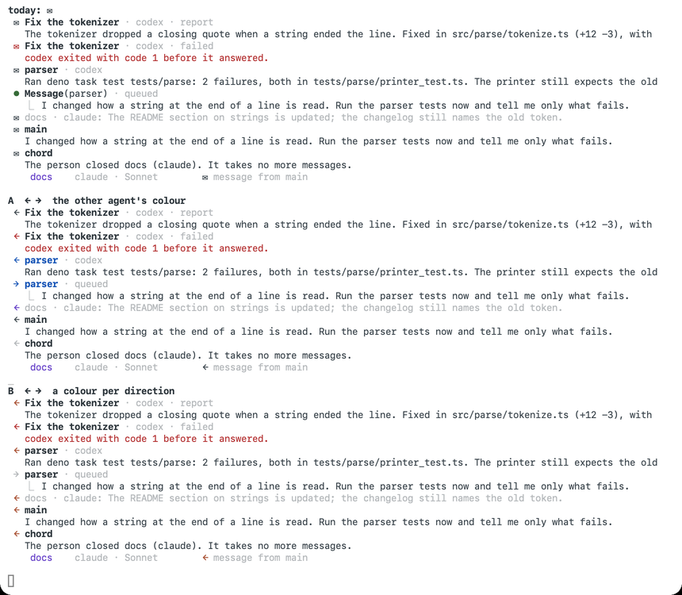
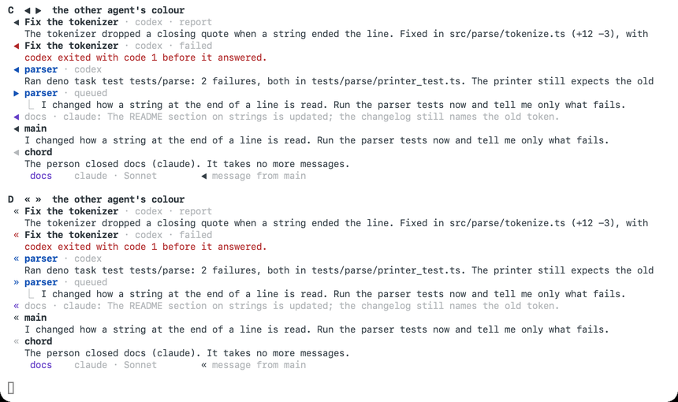

# CHD-225: The message glyph

`✉` marks every message between agents today: a task's report, a message from
another agent or from chord, a queued message and the agent list's
`✉ message from main`. The owner saw it small and unreadable in Ghostty, and it
does not say which way a message went. This document puts four replacements
side by side for the owner to pick.

**Picked: A.** The owner chose `←` and `→` in the colour of the agent at the
other end, as laid out below, including a sent message becoming `→ name`
instead of `⏺ Message(name)`.

## Why `✉` reads badly

The glyph is fine. The fonts are the problem. `✉` (U+2709) is in none of the
monospace fonts the three terminals start with, so each terminal borrows it
from another font:

| Font | Used by default in | `✉` | `←` `→` | `◀` `▶` | `«` `»` |
| --- | --- | --- | --- | --- | --- |
| JetBrains Mono | Ghostty (built in) | no | yes | yes | yes |
| SF Mono | Terminal.app | no | yes | yes | yes |
| Menlo | iTerm2 (default profile, by version) | yes | yes | yes | yes |
| Monaco | iTerm2 (default profile, by version), Terminal.app "Pro" | no | `→` only | no | yes |

On macOS the only font that has `✉` besides Menlo is Apple Color Emoji, because
`✉` is an emoji with text presentation by default. Ghostty most likely picks
the emoji font for it and squeezes the picture into one cell, which would be
the small envelope the owner saw. Terminal.app falls back the same way: `widths-*.png` show
it tiny in JetBrains Mono NF, SF Mono and Monaco alike. `◂` and `▸` (the small
triangles) are in every font but draw just as small, so they were dropped.

## Width

A glyph in the gutter must take exactly one cell, or the text after it moves.

- **Terminal.app, seen.** `widths-jetbrains-mono-nf.png`, `widths-sf-mono.png`
  and `widths-monaco.png` print each candidate between `|` bars over a row of
  `|x|`. Every bar lines up in all three fonts, including where Monaco
  borrows `←` from another font.
- **Ghostty and iTerm2: not installed on this machine, so not seen.** The cell
  width there comes from Unicode, not from the font. `←`, `→`, `◀` and `▶` are
  East Asian *Ambiguous*, which both terminals draw one cell wide unless the
  person turns on "ambiguous characters are double-width". With that setting
  on, chord already breaks: the box's `╭─│╰` and the list's `●` are Ambiguous
  too. So the arrows bring no new risk. `«` and `»` are *Neutral*, one cell
  wide under every setting. `✉` is also Neutral, so its width was never the
  problem, only its size.
- **Ink.** `string-width` (Ink's measure) gives 1 for every candidate with its
  default `ambiguousIsNarrow`, so the layout agrees with the terminals.

Before the build ships, the owner can confirm the Ghostty case with one line:
`printf '|←|→|◀|▶|«|»|\n|x|x|x|x|x|x|\n'`.

## The options

Every option changes the same rows. *In* is what came to the session on
screen, and *out* is what it sent.

| Row | Today |
| --- | --- |
| A task's report (in) | `✉ Fix the tokenizer · codex · report` |
| A failed report (in) | `✉ Fix the tokenizer · codex · failed`, red |
| A message from a child (in) | `✉ parser · codex` |
| A message the session sent (out) | `⏺ Message(parser)` with the text under `⎿` |
| A queued message (in) | `✉ docs · claude: <first line>…`, dim |
| The child-focused view, from main (in) | `✉ main` |
| From chord itself (in) | `✉ chord` |
| The agent list's hint | `✉ message from main` |

The *out* row changes in every option. A sent message stops being a
`⏺ Message(name)` tool call and becomes `→ name` (or the option's out glyph),
with the text still under `⎿` and `· queued` still dim after it. That way the
two sides of an exchange use one pair of glyphs. The call's states move onto
the glyph: dim while it is delivering, red when chord refuses it (a closed
agent). Inside a task block's `⎿` list, the child's `Message(main) · queued`
becomes `→ main · queued` the same way.

In the parent's transcript, `Agent(…)` and `Open(name)` stay `⏺` tool calls.
They start an agent, which is more than a message.

### A. `←` `→` in the other agent's colour (the owner's arrows)

```
 ← Fix the tokenizer · codex · report
 → parser · queued
   ⎿  I changed how a string at the end of a line is read. …
 ← parser · codex
 ← docs · claude: The README section on strings is updated; the changelog stil…
 ← main
 ← chord
    docs    claude · Sonnet        ← message from main
```

- The arrow and the name are in the colour of the agent at the other end:
  parser's blue whichever way the message went. That colour is already the
  name's colour in the list and the colour of the box while the agent is
  picked (CHD-167). A task's report, `main` and `chord` have no colour, so
  their arrows are plain (`chord` dim). A failed report's arrow is red.
- For: it reads at a glance in every font tried, and the direction is the
  shape, so it survives `NO_COLOR` and colour blindness. Colour on screen
  keeps one meaning: which agent.
- Against: a task's report and a message from main get no colour, so they
  stand out less than a child's message.

### B. `←` `→`, one colour per direction

The same glyphs and rows as A. Every *in* arrow is drawn in the theme's
`accent` (dark `#d77757`, light `#b9532f`) and every *out* arrow is dim. Names
stay bold, uncoloured.

- For: everything that came in is the same orange, so a long transcript can be
  scanned for it. Reports and messages from main stand out as much as a
  child's.
- Against: `accent` is also the colour of `✻ Working…`, so an orange arrow just
  above the working line reads as part of it (see the queued row in
  `sheet-dark-1.png`). Colour then means two things on screen, an agent in the
  list and box and a direction in the transcript. If the owner prefers B, the
  in colour should be a new theme role rather than `accent`.

### C. `◀` `▶` in the other agent's colour

```
 ◀ parser · codex
 ▶ parser · queued
```

- For: the heaviest of the four, solid in both themes and in every font tried.
- Against: `▶` reads as *play* or *expand*, and chord already uses `❯` for the
  picked row. Both glyphs are emoji with text presentation by default, the
  same family as `✉`. A terminal that prefers emoji presentation would draw
  them as pictures again.

### D. `«` `»` in the other agent's colour

```
 « parser · codex
 » parser · queued
```

- For: Latin-1, so it is in every monospace font ever made, Monaco included,
  and Neutral width, so no terminal setting can widen it. It reads as quoted
  speech.
- Against: the direction is weak, since `«` does not say *came in* as plainly
  as `←`. Worse, `»` is a doubled `›`, the person's own prompt glyph. CHD-167's
  rule is that nothing an agent wrote may look like the person's words, and
  `» parser` comes close.

## Side by side

Every row each option touches, with chord's own dark and light palettes and
the agent colours from CHD-167 (parser blue, docs purple). They were rendered
in Terminal.app at 120 columns: dark in JetBrains Mono NF (the font Ghostty
ships), light in SF Mono.

| | today, A, B | C, D |
| --- | --- | --- |
| dark |  |  |
| light |  |  |

The whole screens, as text, at 120×40 and 80×24, for the parent with the list
under the box and for parser picked: `evidence/CHD-225/<cols>-<option>-parent.txt`
and `<cols>-<option>-child.txt`, with `today` beside A–D. These are mocks
printed into tmux, not chord: the agent list is not built yet. Option A at
80×24 (`80-A-parent.txt` and `80-A-child.txt`):

```
 → parser
   ⎿  I changed how a string at the end of a line is read. Run the parser tests
      now and tell me only what fails.

 ← parser · codex
   Ran deno task test tests/parse: 2 failures, both in
   tests/parse/printer_test.ts. The printer still expects the old token for a
   trailing quote.

 ⏺ Two printer tests expect the old token. I will update the printer.

 ✻ Working… (34s · esc to interrupt)
 ← docs · claude: The README section on strings is updated; the changelog stil…

╭──────────────────────────────────────────────────────────────────────────────╮
│ ›                                                                            │
╰──────────────────────────────────────────────────────────────────────────────╯
  ? for shortcuts                                      Opus · 91% context left
    main    claude · Opus
    parser  codex                  ✻ working 12s
    docs    claude · Sonnet        ← message from main
```

```
 parser · codex · gpt-5.3-codex · opened by main 4m ago

 ← main
   I changed how a string at the end of a line is read. Run the parser tests
   now and tell me only what fails.

 ⏺ Bash(deno task test tests/parse)
   ⎿  2 failed, 212 passed

 → main
   ⎿  Ran deno task test tests/parse: 2 failures, both in
      tests/parse/printer_test.ts. The printer still expects the old token for
      a trailing quote.

 ✻ Working… (12s · esc to interrupt)

╭─ parser ─────────────────────────────────────────────────────────────────────╮
│ ›                                                                            │
╰──────────────────────────────────────────────────────────────────────────────╯
  ↑ ↓ pick · enter write · x close · esc back
    main    claude · Opus
  ❯ parser  codex                  ✻ working 12s
    docs    claude · Sonnet        ← message from main
```

The `←` and `→` sit in the same column as `⏺` and `›` and read as clearly as
either at both sizes. The child-focused view is where the direction matters
most: `← main` then `→ main` reads as an exchange without reading the words.

## Recommendation

**A.** The owner's arrows read best in every font tried, and their direction
is in the shape. They take the other agent's colour, which CHD-167 already
gives each child, so colour on screen keeps one meaning. B's single in colour
helps scanning, but it either collides with `✻ Working…` or adds a colour
role that means something different from every other colour in the list.

## Keys

No new action, so no new key. ctrl+o still unfolds a message, as it does today.

## What the build changes

- The `✉` in `Transcript.tsx`'s message row and the prompt queue's message
  row, and the list's hint, become `←`.
- The sent row (`Message(name)` from chord's `send_message` tool, the parent's
  and a child's) becomes `→` and the name, with the states above.
- CHD-167.md's rows that show `✉` are rewritten to `←` and `→`, and so is
  the `MessageFrom` doc comment.
- `<message from="…">`, the wrapper the agent reads, does not change. Only
  the screen does.
