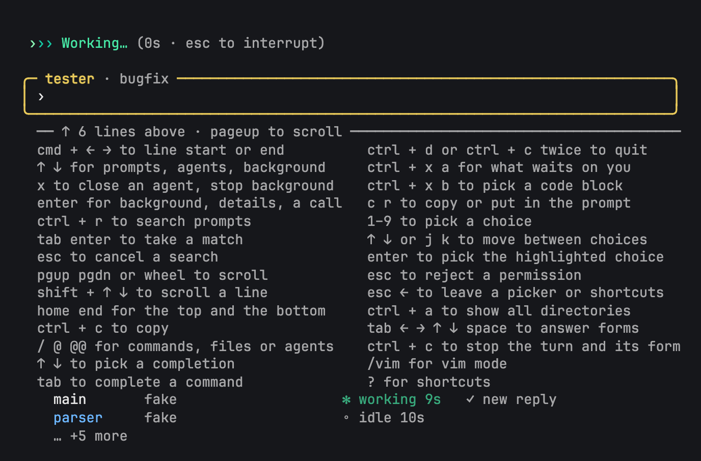
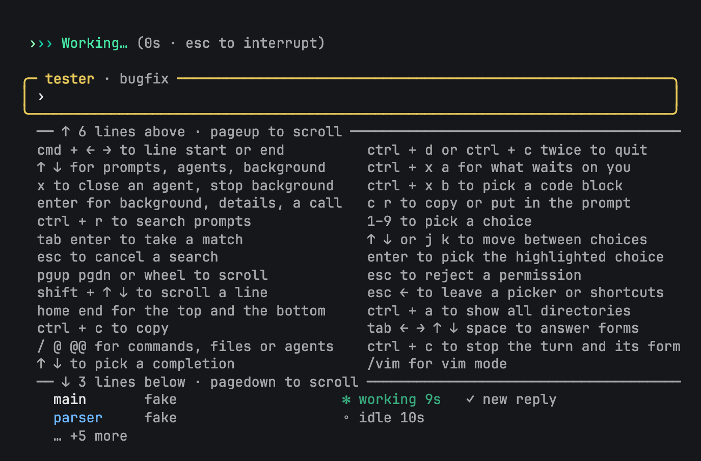

# CHD-530: shortcuts stay truthful when a turn starts

Design: [CHD-378's scrolling panel](../../CHD-378-steer.md), with
[CHD-528's whole rows and separate rules](../CHD-528/README.md).
No new screen design or keys.

Before is origin/main `6c768978`, run from a temporary archive. After is
corrected screen unit `7391039c` on `CHD-530` (following `60827b97`).
Every PNG is a whole-window live tmux capture, rendered from its matching
`.ansi` with CHD-528's existing AnsiUp/Puppeteer renderer; `.txt` is the
plain screen. No harness frames or mocks are used. All PNGs were inspected.

| File stem | Screen |
| --- | --- |
| `before-idle-end-80x24` | Baseline: idle tester, panel at End; final row visible |
| `before-broken-80x24` | Baseline: Working arrives; final rows vanish without a below rule |
| `after-idle-end-80x24` | Fix: same idle tester and panel at End |
| `after-transition-80x24` | Fix: first captured Working frame; truthful three-row below rule |
| `after-working-end-80x24` | Fix: End reaches the final row while Working remains |
| `after-transition-120x40` | Fix: first captured Working frame; complete panel, no rules needed |

| origin/main, 80x24 | Fix, 80x24 |
| --- | --- |
|  |  |

The narrow fix keeps shortcuts and rules on separate rows. Its first
captured Working frame says `↑ 6 lines above` and `↓ 3 lines below`:
three remaining rows are hidden. End reaches those rows, including
`tab enter to add a file or agent`, with the below rule gone. The wide
panel fits completely. The prompt, working line and roster remain
readable together. The screen look passes; no findings remain.

## Reproduction and limits

Run `bun dev chord --qa chd530 --fake` in a designer-owned tmux session
at each size, with `NO_COLOR` removed and these existing fake options:

```sh
CHORD_FAKE_STEP_MS=100
CHORD_FAKE_TESTER_PLAYS=text
CHORD_FAKE_HOLD_REPLY=1
```

After startup, copy the existing fake `bugfix.md` team fixture into the
QA directory's `.chord/teams/`. Create `.fake-gate/release` there. Send
`agentmentions` with `send-keys -l`, then Enter in a separate call. Once
the roster opens, five Down presses and Enter select tester. After its
initial reply ends, open `?`, press End, and remove the release file.
The fake coder's delayed normal message starts tester again while the
panel stays open; its reply waits on the existing gate.

The baseline failure is brief: ordinary settled captures already show a
correct below rule. A bounded rerun polled `capture-pane -e -p` and saved
the single matching broken colour frame atomically. The corrected fix
run saved its first captured Working frame directly, then checked 100
successive tmux samples at each size. At 80x24 each had the exact positive
three-row below count; at 120x40 all rows remained visible. These are tmux
samples, not proof of every emitted render frame. Developer's regression
covers that boundary. The original fix's settled captures were discarded
after its first-frame zero-count finding; only `7391039c` is shown here.

Only the fake agent was used. All designer tmux sessions were killed,
and the temporary baseline archive and QA directory were removed.
Privacy, changed-file formatting and diff whitespace were checked before
committing. No light theme, wheel interaction, compile, static check or
application test suite was run for this screen look; automated fix
checks belong to the developer and tester handovers.
